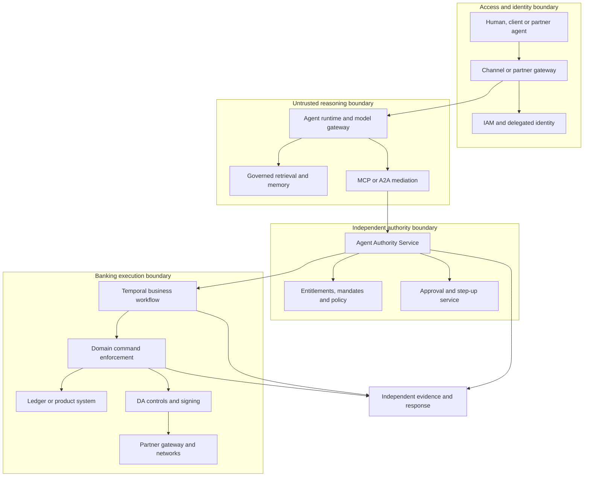

# CIB Agent Architecture Standards and Reference Implementations

**Version:** 0.1 — recommended draft for architecture and control-owner review  
**Prepared:** 9 November 2026  
**Audience:** CIB Chief/Domain Architects, Channels, Digital Assets, Data Platforms, IAM, CISO, Model Risk, FCC, Operations and delivery leads  
**Scope:** internal agents, client/partner agents, embedded vendor agents and engineering agents that access CIB information or services.

## Executive Take

Adopt one enterprise agent control architecture with domain-owned execution. The agent may investigate, reason and propose; independently enforced services determine its authority and the banking domain determines whether an action can be accepted, booked, settled or reversed.

Five decisions establish the foundation:

1. Make **purpose, delegated authority, consequence and reversibility** the basis for approval and control intensity.
2. Establish an **Agent Authority Service** and enforcement points, reusing enterprise IAM, entitlements, product controls and client mandates.
3. Keep **domain APIs and ledgers authoritative** for financial and customer outcomes. MCP and A2A are interfaces, not sources of authority.
4. Separate **memory, workflow state, authorization state and financial state**; assign each a system of record and owner.
5. Release a versioned **agent-service bundle** only after adversarial, domain, resilience and operational acceptance evidence passes.

The Agent Authority Gateway is a logical capability, not necessarily another gateway product. In an existing gateway/service-mesh estate it can be implemented through shared identity, mandate, policy and audit services with enforcement at ingress, tool mediation and domain command acceptance.

### Status and interpretation

- **MUST / MUST NOT** below express proposed internal bank standards, subject to approval. They are not assertions that a regulator mandates the exact implementation.
- **SHOULD** requires a reasoned alternative; **MAY** permits an option. Numeric defaults are proposed starting points, not regulatory limits.
- A source-backed technical fact is identified by a source reference. Component choices, control profiles, thresholds and CIB mappings are recommendations.
- This draft does not certify legal compliance, FAPI conformance, production safety or a vendor product. Legal/Compliance determine jurisdictional applicability; control owners approve the internal baseline.
- The executable pack is a **local reference**, using synthetic data. Production integrations and untested blueprints are explicitly distinguished in the implementation guide.

## 1. Classify the service, its authority and its consequences

Do not approve a model in isolation. Inventory and assess the combination of business journey, principal, corporate entity, agent release, model route, tools, data, memory, operational privileges and execution limits.

### 1.1 Consequence tiers

| Tier | Typical CIB use | Required default control posture |
|---|---|---|
| C0 — public information | Product education from approved public content | Source grounding, publication controls, no client data or execution credentials |
| C1 — protected insight | Account inquiry, relationship-manager research, document summarization | Need-to-know, delegated data access, provenance, leakage controls, purpose isolation |
| C2 — controlled workflow change | Draft onboarding case, prepare payment, propose entitlement change | Explicit write scope, validation, idempotency, review before consequential activation |
| C3 — financial/client consequence | Release payment, FX order, MMF subscription, token mint/burn, client communication with contractual effect | Transaction-bound authority, segregation of duties, live domain controls, durable evidence, bounded execution and tested recovery |
| C4 — privileged or systemic consequence | Modify sanctions rules, raise bank-wide limits, change signing policy, export keys, override ledger controls | Autonomous execution prohibited in the initial baseline; independently authorized specialist workflow and separate privileged identities |

A read-only agent can still be high risk because of sensitive data, aggregation or customer communication. A small deterministic tool can be C3/C4. Consider cumulative impact across many small actions, not just the maximum single action.

### 1.2 Autonomy is a separate axis

| Level | Agent authority | Approval semantics |
|---|---|---|
| A0 | Analyze and recommend | A person/domain service initiates any effect |
| A1 | Prepare a structured proposal | Approval does not follow from a chat response |
| A2 | Execute within a preapproved standing mandate | Each action is checked against the live mandate and product controls |
| A3 | Plan and execute a bounded multi-step task | Bounded tools, delegation, time, cost, transaction and aggregate exposure; checkpoints at risk transitions |

C3/A2 is possible where the corporate mandate, product policy and jurisdiction permit it. A2 is not permission to bypass maker-checker: the standing mandate must itself have the appropriate approval chain, and product-specific release rules continue to apply. C4 autonomy requires a separately approved exception and is outside the initial reference implementation.

Model capability is an additional risk factor: code execution, cyber capability, tool use and context size can raise the required controls. Automatic model routing MUST NOT increase capability, data exposure or authority beyond the approved service profile.

**Source basis:** the OCC examiner framework emphasizes consequence and transferred agency; it is examiner guidance rather than new bank requirements. MAS supplies the relevant Singapore supervisory baseline. [S01], [S02]

## 2. Reference architecture and trust boundaries

### 2.1 Responsibilities that MUST remain distinct

| Component | Owns | Does not own |
|---|---|---|
| Channel platform | Session, consent capture, client interaction, journey initiation, step-up and notification | Product liability, settlement finality, product ledger |
| Agent runtime | Planning within approved budget; proposed actions; response composition | Entitlements, mandates, signing keys, screening decisions, financial truth |
| Model gateway | Approved model/provider routing, data-location controls, cost and model-access policy | Customer consent or payment authorization |
| Agent Authority Service | Mandate interpretation through deterministic policy; action-specific execution grant; approval linkage | Product booking, live liquidity, settlement or legal finality |
| Entitlements service/graph | Current relationships, account access, roles, segregation rules | A blanket authorization for every action an agent can invent |
| Temporal | Durable progress, timers, retries, recovery coordination | Financial ledger; cross-system exactly-once delivery; live authority merely because an old decision is in history |
| Product domain service | Acceptance, product validation, balance/limit checks, booking, idempotent outcome | Model reasoning |
| DA control and primitive layers | Wallet rules, signing, supply controls, reconciliation, chain connectivity, finality monitoring | Corporate principal authority inferred from a wallet or provider API key |
| Data platform/knowledge graph | Approved facts, lineage, data entitlements, business definitions | Unreviewed inference promoted into an entitlement, instruction or financial record |
| Evidence platform | Protected business/control records, incident reconstruction and retention | Unrestricted collection of secrets, personal data or hidden model reasoning |

### 2.2 The permission decision

**Effective permission = current principal entitlement ∩ current corporate mandate ∩ agent/service permission ∩ tool permission ∩ product/legal-entity policy ∩ current risk/limit state.**

Every element is required. An agent must not gain authority by combining individually permitted tool calls into an unapproved outcome. Task-level policy must therefore constrain the end-to-end objective as well as each call.

The gateway performs early rejection. The receiving domain performs the final check at its own command-acceptance boundary. This prevents a gateway authorization from becoming a stale, unrestricted promise to execute later.

## 3. Recommended standards across the ten areas

### 3.1 Architecture principles — AG-ARC

**Accountable owners:** CIB Chief Architect and product/domain architects.

| ID | Recommended requirement | Reference implementation and review evidence |
|---|---|---|
| AG-ARC-01 | MUST register a bounded agent service with business purpose, owner, consequence/autonomy tier, data classes, tools, jurisdictions and prohibited actions. | Versioned service manifest; CMDB/model/tool registry links; sample `examples/agent-service-profile.yaml` |
| AG-ARC-02 | MUST isolate reasoning from authorization and execution. Model-produced policy explanations or `approved=true` fields are not control decisions. | Independent PDP/mandate service; tool schemas exclude caller-provided identity and approval fields |
| AG-ARC-03 | MUST invoke governed domain services for financial effects. No direct model access to core tables, private keys, arbitrary SQL writes or chain signing RPCs. | Network isolation plus API allowlists; product-domain command contracts |
| AG-ARC-04 | MUST distinguish a proposed instruction, accepted command, booked outcome and settled/final outcome. | Explicit state machine; separate source-of-truth mappings; no UI success before domain evidence |
| AG-ARC-05 | MUST version the agent-service bundle and reassess material changes to model, prompt, retrieval, tools, policy, memory strategy or authority. | Content-addressed release manifest; migration/revalidation evidence |
| AG-ARC-06 | SHOULD reuse common control services and retain domain ownership. A thin MCP adapter should not duplicate product logic. | Architecture decision records and domain/API catalogue |

**CIB application:** reuse the ENT3 relationship/need-to-know foundation; extend it with agent, task and mandate relationships. Do not assume that the existing user-role graph already models purpose-bound delegation.

**Source inputs:** [S01], [S02], [S03], [S04]. The component decomposition is a recommended bank design.

### 3.2 Controls and policy — AG-CTL

**Accountable owners:** Product Risk, IAM/Authorization, FCC and relevant business control owners.

| ID | Recommended requirement | Reference implementation and review evidence |
|---|---|---|
| AG-CTL-01 | MUST default-deny unknown tools, resources, operations, jurisdictions and unsupported schema versions. | Typed action contracts; policy tests; registered tools with stable operation IDs |
| AG-CTL-02 | MUST derive identity and risk facts from trusted services. The model cannot assert that screening passed, funds are available or a person approved. | Verified identity dependency; server-side policy facts; freshness/version evidence |
| AG-CTL-03 | MUST bind approval to exact material instruction details, principal, agent/task, mandate and expiry. A changed beneficiary, amount, currency, quote, instrument, network or value date requires the applicable reapproval. | Action digest plus signed approval receipt; trusted display of the reviewed instruction |
| AG-CTL-04 | MUST recheck live authority and domain constraints immediately before effect acceptance, with atomic consumption/reservation of mutable limits at the relevant consistency boundary. | Domain transactional guard; reservation ledger; policy/mandate epochs; race tests |
| AG-CTL-05 | MUST enforce per-action and cumulative limits, velocity, concurrency, delegation depth and execution budget. | Limits service and domain counters; task budget; counterparty/product aggregation |
| AG-CTL-06 | MUST fail closed for new consequential actions if authorization, screening, revocation freshness or durable acceptance evidence cannot be established. | Dependency fault injection; explicit error taxonomy and escalation |
| AG-CTL-07 | MUST separate emergency suspension from recovery/re-enablement. An agent cannot reset its own breakers, increase limits or approve its own exceptions. | Independently authenticated control API; incident case; re-enable approval |

An OPA/Rego or Cedar-based PDP is an implementation option, not a substitute for bank-owned semantics. Reuse an approved policy engine; sign/version bundles, constrain fact freshness, test deny and indeterminate cases, and protect decision logs. The executable local reference uses a small Python PDP so the security invariants can be run without a deployed policy service; it is not a proposal to build a new production authorization engine. [S05], [S06]

**Important:** DPoP binds a token to a sender and request context but does not sign the HTTP body. An action-specific signed object/digest or an approved message-signing profile is still needed for exact transaction binding. A signature improves evidence; legal non-repudiation also depends on identity, authority, key custody, record retention and legal arrangements. [S07], [S08]

### 3.3 Digital channels and domain initiation — AG-CHN

**Accountable owners:** Channels, Customer Administration/Entitlements and relevant product owners.

| ID | Recommended requirement | Reference implementation and review evidence |
|---|---|---|
| AG-CHN-01 | MUST expose agent access as a governed channel type. Client-owned, bank-owned and partner-owned agents require explicit registration and trust policies. | Channel onboarding records; partner risk profile; allowed routes and service levels |
| AG-CHN-02 | MUST preserve corporate party/legal entity, authenticated user or system principal, acting agent, task, mandate, purpose, jurisdiction and correlation references. | Signed/delegated context outside model text; derive fields at the authenticated boundary |
| AG-CHN-03 | MUST capture both intent and release authority. Agent login and user data access alone do not authorize a payment, new beneficiary or entitlement grant. | Proposal/approval/release APIs; product-specific maker-checker and step-up |
| AG-CHN-04 | MUST present material instruction details through a trusted UI or approved corporate signing channel for human approval; an agent-rendered summary cannot be the only evidence. | Transaction-bound challenge; expiry; clear action preview; rejection and dispute journey |
| AG-CHN-05 | MUST provide idempotency, status lookup, safe cancellation semantics, notifications and dispute references. Cancellation after acceptance is not guaranteed reversal. | Business operation ID; domain receipt; separate cancel/recall/reversal APIs |
| AG-CHN-06 | MUST prohibit credential sharing and unapproved DOM/screen automation for production financial initiation. | FAPI-aligned APIs and delegated access; no client password vault operated by an agent |

**Channel API catalogue alignment:**

| Existing category | Recommended reusable services |
|---|---|
| Channel-Platform | Agent registration/trust, session, delegated context, intent capture, task status, step-up, channel fraud telemetry |
| Channel-Product | Payment/FX/trade/DA initiation adapters; quote and preparation views; domain submission and receipt retrieval |
| Self Servicing | Corporate mandate creation/revocation; agent onboarding; account/tool permissions; maker-checker administration |
| Customer Reporting | Action history, mandate usage, exceptions, transaction evidence and reconciled status |
| Other shared capabilities | Notifications, secure documents, consent records, complaint/dispute case references |

Product domains retain final initiation validation, accepted command data, booking and outcomes. Channel-specific drafts and interaction data remain channel-owned with references to product commands.

**Identity implementation:** use the bank's approved OAuth/OIDC authorization server. For applicable high-security confidential-client APIs, implement the complete FAPI 2.0 Security Profile, including its PAR, PKCE, issuer-validation and sender-constraint requirements. A browser/mobile front end generally uses a confidential backend or another separately approved profile; do not claim that an ordinary public client is FAPI 2.0 compliant. [S09], [S10]

### 3.4 Interoperability and delegation — AG-INT

**Accountable owners:** Integration Architecture, IAM and domain API owners.

| ID | Recommended requirement | Reference implementation and review evidence |
|---|---|---|
| AG-INT-01 | MUST distinguish synchronous command/query APIs, event APIs, MCP tools and A2A delegated tasks. Each maps to the same domain authorization semantics. | OpenAPI, AsyncAPI, tool registry and task contracts |
| AG-INT-02 | MUST pin protocol, SDK and extension versions in the release bundle; negotiate only an approved set and test downgrade/unknown-capability handling. | MCP dated baseline and A2A version; compatibility matrix; conformance tests |
| AG-INT-03 | MUST validate issuer, audience, token type, time, client/workload binding and scope at each receiving resource. Never pass an incoming token to a different audience. | Token exchange through approved STS or separately obtained downstream token; deny token passthrough |
| AG-INT-04 | MUST preserve the originating principal and the actual actor at each delegation. Rights may narrow; child agents cannot expand scope, lifetime, budgets or delegate further by default. | Parent/child mandate links; actor chain; explicit delegation depth and shared budget |
| AG-INT-05 | MUST treat agent cards, tool descriptions, annotations and returned content as untrusted claims until approved and verified. Discovery does not grant permission. | Authenticated registry, metadata/release digest, signed or authenticated cards, secrets excluded |
| AG-INT-06 | MUST protect A2A task status, artifacts, subscriptions, callbacks and cancellation with tenant/task access control. Validate callback destinations and signatures; block SSRF/replay. | Partner gateway termination; destination allowlist; signed callback verification and deduplication |

**Bank KYA profile:** identify the legal provider, bank sponsor, business purpose, agent ID/release, workload instances, authorized principals, data/operation reach, assurance evidence, incident contact and revocation mechanism. KYA complements client KYC; it is not a universal replacement or a single finalized industry protocol.

**Current engineering baseline:** the reviewed MCP dated specification is `2026-07-28`; A2A is `v1.0.0`. MCP authorization still references OAuth 2.1 as an IETF draft. Adopt the bank's approved, interoperable security profile; do not label every part of MCP/OAuth 2.1 as a finalized banking standard. RFC 8693 supports token exchange and actor/delegation representations; RFC 9396 supplies rich authorization details. Neither defines a complete CIB mandate or legal authority model. [S11], [S12], [S13], [S14], [S15]

### 3.5 Operating model and ownership — AG-OPS

**Accountable owners:** Business Service Owner with Technology Service Owner; independent second/third-line challenge.

| ID | Recommended requirement | Reference implementation and review evidence |
|---|---|---|
| AG-OPS-01 | MUST assign named owners for business outcomes, platform operation, data, policy, models, tools and third-party services. | Service registry; accountable sponsor; runbooks and on-call ownership |
| AG-OPS-02 | MUST define who can approve, deploy, modify authority, suspend, reconcile, remediate clients and re-enable a service. | Decision-rights matrix; separate production privileges |
| AG-OPS-03 | MUST evidence meaningful human review: exact object shown, reviewer entitlement, challenge, decision, time and signed receipt. | Trusted approval service; workload/span-of-control testing |
| AG-OPS-04 | MUST assign incident ownership for incorrect-but-available operation and uncertain outcomes. | Joint AI/technology/business incident taxonomy and escalation |
| AG-OPS-05 | MUST re-attest material agents and retire orphaned agents, credentials, tools, memory and provider permissions. | Scheduled certification with named owner and expiry |
| AG-OPS-06 | SHOULD use shared platform enablement with domain-owned products, rather than a central team approving every low-risk prompt change. | Tier-based paved paths; automated evidence; independent sample review |

For 24/7 agentic treasury or DA activity, the service must have 24/7 operational capability or explicit operating-window and stress-mode restrictions. Ledger availability alone is insufficient.

### 3.6 Resilience, orchestration and financial effects — AG-RES

**Accountable owners:** Product Operations, SRE and business continuity owners.

| ID | Recommended requirement | Reference implementation and review evidence |
|---|---|---|
| AG-RES-01 | MUST define correctness and authorization SLIs alongside availability, latency and cost. A service producing wrong actions is an integrity incident. | Business outcome monitoring, semantic correctness alerts and targeted stop |
| AG-RES-02 | MUST use durable workflow state for material multi-step journeys. Workflow code is deterministic; LLM/API effects are Activities. | Temporal workflows; replay tests; versioned workers and safe workflow evolution |
| AG-RES-03 | MUST make side-effecting domain endpoints idempotent with payload conflict detection and stable operation IDs. Exactly-once financial effect requires domain enforcement, not an orchestrator promise. | Domain idempotency store; transactional ledger/counters/outbox; duplicate/race tests |
| AG-RES-04 | MUST distinguish business denial, transient transport error, unavailable dependency and unknown financial outcome. | Typed errors; bounded retries; original-key lookup; reconciliation queue |
| AG-RES-05 | MUST not blindly retry a non-idempotent submission or generate a new key after timeout. | Submit-once then query/reconcile; provider idempotency contract; explicit manual escalation |
| AG-RES-06 | MUST recheck live authority after waits, retries, failover or material state changes. A recorded approval or Workflow history is not current permission. | Fresh capability at acceptance; mandate/policy versions; revocation tests |
| AG-RES-07 | MUST test suspension, in-flight containment, dependency failure, region loss, provider exit and safe return to service. | Game days with domain outcomes and ledger reconciliation |
| AG-RES-08 | MUST use controlled compensating business transactions where permitted. Final payments, fills and on-chain settlements cannot simply be rolled back. | Recall/reversal/new journal entry with fresh authority; no replay of old approvals |

Temporal namespaces/task queues can separate products and operational ownership, but are not by themselves full data or infrastructure isolation. Apply authorization, worker/secret isolation, payload encryption, storage segregation where required and jurisdiction-specific placement. Do not store bearer tokens, signing keys or unnecessary client data in histories or search attributes. [S16], [S17], [S18]

**Distributed consistency:** the local reference places limits, grant consumption, ledger entries and evidence in one SQLite transaction. Production should place the invariant in the product's consistency boundary or use durable, idempotent reservations. No database transaction can atomically cover an arbitrary external rail. Reconcile remote acceptance; do not release reservations after a timeout until the domain establishes a safe outcome.

### 3.7 Security and engineering isolation — AG-SEC

**Accountable owners:** CISO/Security Architecture, IAM and platform security.

| ID | Recommended requirement | Reference implementation and review evidence |
|---|---|---|
| AG-SEC-01 | MUST distinguish logical agent identity, release identity, ephemeral workload instance, user/corporate principal and task. Use attested workload identity and authenticated service transport. | SPIFFE/SPIRE or bank workload PKI; short-lived X.509 credentials; approved STS |
| AG-SEC-02 | MUST broker credentials outside model context and keep key use behind HSM/KMS policy. No credentials in prompts, tool responses, memory, logs or agent cards. | Credential broker; HSM transaction signing with separate approval and key administration |
| AG-SEC-03 | MUST enforce egress allowlists independently of the agent. Include DNS, package registries, telemetry, object stores, proxies and update paths in threat modeling. | Egress proxy/firewall; private endpoints; controlled package mirror; SSRF/DNS-rebinding defenses |
| AG-SEC-04 | MUST isolate untrusted code and task state. General agent runtimes cannot share host mounts, credentials or writable stores across tenants/tasks. | Restricted containers for trusted services; hardened sandbox/microVM or equivalent for untrusted code |
| AG-SEC-05 | MUST validate tool schemas, outputs, URLs, file paths and payload sizes. Never execute model-generated SQL, shell or templates with elevated production authority. | Parameterized domain commands; executable allowlists; output treatment as data |
| AG-SEC-06 | MUST test prompt injection, goal hijack, tool poisoning, memory poisoning, credential theft, exfiltration and cross-agent privilege chaining. | Adversarial evaluation suite plus infrastructure penetration testing |
| AG-SEC-07 | MUST protect policy, registry, kill-switch and evidence services from agent modification. Break-glass access must be independently authenticated and audited. | Separate management plane and service accounts; explicit change controls |
| AG-SEC-08 | SHOULD maintain cryptographic inventory and algorithm agility, including long-lived DLT signatures and evidence. | Approved cryptographic roadmap; HSM/vendor compatibility assessment; no unvalidated crypto substitution |

SPIFFE authenticates workloads; it does not establish a client's financial mandate. A container is not a complete hostile-code isolation guarantee, and a network-isolated signing service is not automatically air-gapped. Design and test the real ingress/egress and administration paths. [S19], [S20], [S21]

### 3.8 Data governance, knowledge and memory — AG-DAT

**Accountable owners:** CIB Data Owner, data platform, privacy/records and product data stewards.

| ID | Recommended requirement | Reference implementation and review evidence |
|---|---|---|
| AG-DAT-01 | MUST classify source data and derived prompts, results, embeddings, traces, memory and inferred relationships. | Catalogue/lineage tags, purpose and regional placement policies |
| AG-DAT-02 | MUST enforce current source access at retrieval and before disclosure. A vector-store match or graph traversal must not bypass need-to-know. | Entitlement-aware retrieval with source/version references and output authorization |
| AG-DAT-03 | MUST separate source records, analytical context, agent memory, workflow state, authorization and ledger state. | Explicit stores and ownership; memory cannot authorize an action |
| AG-DAT-04 | MUST distinguish proposed from approved durable memory, with provenance, source version, owner, purpose, retention and correction paths. | Quarantine/stewardship pipeline; immutable source evidence; versioned working memory |
| AG-DAT-05 | MUST prevent cross-tenant, cross-client and cross-purpose retrieval/cache contamination. | Scope cache by legal entity, principal/entitlement version, purpose, jurisdiction, model and data snapshot |
| AG-DAT-06 | MUST implement retention, erasure/restriction and legal hold across active stores, indexes, caches, exports and restoration processes. | Deletion manifest; tombstones; backup expiry and post-restore re-deletion; held data restricted |
| AG-DAT-07 | MUST retain deterministic data lineage for regulatory and financial outputs. | Source snapshot, calculation version, business definition and evidence references |
| AG-DAT-08 | SHOULD use the existing enterprise/client graph for explicit relationships and versioned business semantics, with probabilistic associations separately labeled. | Neo4j/ENT3 extension; approved ontology; provenance/confidence on inferred edges |

Do not require hidden chain-of-thought as evidence. Retain inputs or protected references, retrieved source IDs, tool calls, policy decisions, approvals, outputs and concise decision summaries appropriate to the use case. Explanations generated by a model are not proof of its actual internal reasoning.

Use Unity Catalog/approved catalog controls for the data estate and bank-owned semantics across platforms. A model gateway or vendor ontology does not become the authority for business meaning. Risk/reporting data should align with applicable BCBS 239 governance, accuracy, completeness, timeliness and lineage expectations. [S01], [S02], [S22], [S23]

### 3.9 Vendor strategy and supply chain — AG-VEN

**Accountable owners:** Technology sourcing/TPRM, product owner, Security, Data and Architecture.

| ID | Recommended requirement | Reference implementation and review evidence |
|---|---|---|
| AG-VEN-01 | MUST inventory model, agent runtime, MCP/A2A services, tools, data sources, cloud, telemetry, identity and recovery dependencies, including material fourth parties. | Technology dependency graph mapped to business services and jurisdictions |
| AG-VEN-02 | MUST obtain usable evidence on provider-agent authority, data use, retention, regional processing, subprocessors, security controls and human-access paths. | Due-diligence questionnaire and executable assurance tests |
| AG-VEN-03 | MUST control silent feature/model/tool changes and routing to unapproved providers or regions. | Version pins or change notification; canary/eval gate; approved-route registry; drift response |
| AG-VEN-04 | MUST define incident vocabulary, notification terms, customer harm handling, audit access and exit support. | Contract schedules with measurable responsibilities; tested evidence export |
| AG-VEN-05 | MUST retain portable business objects, policies, mandates, tool contracts, memory export and evidence. Avoid core logic confined to one agent framework or lakehouse. | Bank-owned canonical contracts; adapter layer; stressed-exit rehearsal |
| AG-VEN-06 | MUST assess common failure domains across apparently different providers. | Model/cloud/identity/HSM/SDK concentration view; alternative paths actually tested |
| AG-VEN-07 | SHOULD use specialist providers where differentiation/assurance is material; avoid adding a provider solely because it can demonstrate a generic agent. | Capability-based build/partner assessment and explicit ownership boundary |

Cloud/private hosting is a placement decision, not proof of sovereignty or security. Self-hosting retains software, patching, staffing and supply-chain dependencies. Select topology per data law, operational feasibility, criticality and exit controls. DORA applies where the relevant entity/activity is in scope; its ICT-risk, testing and third-party requirements should be mapped by Legal/Compliance rather than assumed globally. [S02], [S24]

### 3.10 Regulatory readiness, evidence and assurance — AG-REG

**Accountable owners:** Compliance, AI/Model Risk, Records, Internal Audit and relevant business control owners.

| ID | Recommended requirement | Reference implementation and review evidence |
|---|---|---|
| AG-REG-01 | MUST map each service to applicable jurisdiction, legal entity, product rules, data obligations and existing control ownership. | Regulatory applicability record; interpretation owner; effective-date/change register |
| AG-REG-02 | MUST produce a reconstructable evidence chain from mandate and proposed instruction through approval, live policy, domain acceptance and business outcome. | Correlated control records and signed receipts; protected evidence repository |
| AG-REG-03 | MUST distinguish model proposal, verified fact, human decision, policy decision and financial record. | Explicit event types and provenance, not a single chat transcript |
| AG-REG-04 | MUST assess meaningful oversight, including reviewer capacity, information quality, transaction binding and ability to stop before effect. | Approval usability tests, reviewer entitlement, rejection and override trends |
| AG-REG-05 | MUST test denied and uncertain paths, not just successful demonstrations. | Negative/evasion tests, deterministic domain assertions, failover and recovery evidence |
| AG-REG-06 | MUST independently review C3/C4 services before first production and material authority expansion. | Security, domain risk, AI/Model Risk, legal/compliance and operational sign-off |
| AG-REG-07 | MUST make evidence tamper-resistant with protected retention and independent custody. A locally hash-chained log alone is insufficient. | Transactional outbox, independent collector, WORM/retention lock, signed/anchored checkpoints, controlled evidence access |

Logs must support reconstruction without turning telemetry into an uncontrolled client-data repository. Financial acceptance records cannot be sampled away. General performance traces may be sampled, with security/error exceptions and jurisdictional policy.

**Regulatory/source distinction:** MAS guidelines are supervisory expectations with phased implementation; SAFR is an industry runtime-governance approach; SAGE is an industry/regulatory initiative; OCC's document is an examiner framework; NIST/OWASP are risk/security resources. None automatically certifies a reference implementation. [S01], [S02], [S03], [S04], [S20], [S25]

## 4. CIB-specific banking profiles

These augment all ten areas; they do not replace existing product, FCC, market-risk, credit, privacy or resilience controls.

| Journey | Required domain facts and gates | Agent authority boundary |
|---|---|---|
| Cash reporting/forecasting | Account/party entitlements, current data time, currency/ledger/available-balance distinction, confidentiality, reconciled source | Read approved accounts; recommendations do not constitute liquidity instructions |
| Payments/agentic treasury | Corporate mandate, signatory matrix, maker-checker, beneficiary verification, sanctions/fraud, liquidity, cut-off/value date, fees, currency, per-action and aggregate limits | Prepare versus release separately; deterministic payment service owns acceptance and status |
| FX/investment execution | Product suitability/eligibility where applicable, venue/counterparty, valid quote, notional/currency, tenor, slippage, market/credit limits, trade capture and surveillance | Quote/plan is not order; changed or expired quote requires policy-defined reapproval |
| Trade finance | Legal obligor, facility/credit limits, documentary evidence, sanctions, discrepancy handling, dual control, contingent liability | Extract/draft; authorized product workflow issues/amends guarantees/LCs |
| Client onboarding/KYC | Source provenance, client identity, beneficial ownership, risk rating, sanctions and data consent; human accountability for escalations | Agent collects/proposes; cannot declare KYC complete or waive requirements |
| Customer entitlements | Corporate administrator authority, need-to-know, account/product scope, SoD, cooling-off/step-up where required, removal propagation | No self-grant, role escalation or approval of own changes; normal admin release workflow |
| Coverage/CRM | Client confidentiality and walls, relationship ownership, inside information controls, source/version, outreach consent | Summaries and draft outreach; binding advice/representations require approved journey |
| Tokenized deposits | Issuing bank liability, par-redemption rights, supply caps, ledger/on-chain reconciliation, wallet eligibility, 24/7 liquidity, finality and recovery | Model cannot mint/burn/sign directly; DA Product + Control + Primitive layers enforce |
| Tokenized MMF/bond/collateral | Legal asset versus token, investor eligibility, custody/beneficial ownership, encumbrance, valuation/haircut, corporate actions, DvP, settlement-money eligibility and liquidation under stress | DA Orchestrator coordinates; domain/custody/network records retain defined authority |
| FCC investigations | Data/graph provenance, source confidence, access restrictions, explainable case evidence, sanctions separation, SAR/STR confidentiality | Agent proposes analysis; cannot change screening lists, thresholds or disposition policy |
| Coding/operations agents | Repository/branch/environment scope, supply-chain provenance, protected CI/CD, no production data, least-privilege tools, independent promotion | Agent may propose code; cannot approve its own PR, alter test gates or hold production deploy/signing credentials |

### 4.1 Digital Assets integration

Keep the existing three-layer product/control/primitive approach:

- **DA Product:** counterparty, deposit/fund/bond identity, sub-ledger, fiat anchor/reserves, collateral and exposure.
- **DA Control:** eligibility, Travel Rule where applicable, sanctions/KYT, supply/transaction limits, reconciliation, circuit breakers, exceptions, KRIs, reporting and audit.
- **DA Primitive:** wallet, HSM signing, token contract, node/RPC, chain monitoring, adapters and key ceremonies.

The Agent Authority Service grants permission for a specific business action; the DA Orchestrator and control layer decide how that action progresses. Wallet possession, validator participation, provider API authentication and a valid smart-contract transaction are not substitutes for client authority.

For mint/burn or transfer, bind the authorization to issuer, legal entity, asset/token ID, contract address, chain/network ID, source/destination wallet, quantity/scale, fees/gas policy, expiry and expected finality profile. Observe on-chain result and reconcile against the legal liability or custody record. Signing success is not settlement success.

Keep tokenized deposit, stablecoin, CBDC and conventional cash as distinct claim types. Automated movement between them is a product/liquidity decision and may require fresh authority, screening and legal treatment.

## 5. Common implementation contracts

### 5.1 Trusted execution context

| Field | Authoritative source | Rule |
|---|---|---|
| Corporate party and legal entity | Client master/mandate | Never accepted solely from agent text |
| User or system principal | Verified IAM token | Preserve original subject and distinguish non-human corporate principal |
| Acting agent and release | IAM/agent registry | Registered identity plus approved release digest |
| Workload instance | Attested workload identity | Authenticate the process/channel presenting the request |
| Task and parent delegation | Authority service | Bound to mandate, expiry and shared exposure budget |
| Purpose and jurisdictions | Mandate and service profile | Requested purpose must match approved processing/action purpose |
| Mandate and entitlement versions | Mandate/entitlements service | Freshness and revocation checked before acceptance |
| Instruction digest | Canonical validated business object | Bind all material fields; cross-language vectors required |
| Correlation/causation/operation IDs | Authenticated ingress and domain | Correlation is observability, not authority; scope and validate caller-supplied IDs |

**Never trust arbitrary `X-User`, `X-Agent`, `X-Tenant` or baggage values.** A terminating gateway strips spoofable headers and creates protected context for authenticated downstream peers. The same rule applies to messages: an envelope from an authenticated publisher needs verified delegated context, expiry, authorization and consumer-side checks; topic access alone is insufficient.

### 5.2 Command and event contracts

- Use an approved OpenAPI 3.1+ profile for HTTP commands/queries; AsyncAPI 3.x for messaging/streaming contracts; schema registry compatibility checks for events. Newer versions require toolchain compatibility, not automatic adoption.
- Use domain commands such as `payments.prepare`, `payments.release`, `entitlements.propose-change`, `cash.position.get` and `da.deposit.mint-request`. Do not expose a single `execute_anything` tool.
- Use fixed-precision decimal strings or integer minor units with authoritative currency/asset scale. No floating-point money. The demo deliberately supports SGD only.
- Treat untrusted external text as content, never as code or policy. Parameter validation alone does not establish authority.
- Return explicit domain status and operation ID. For asynchronous acceptance use a status resource/202 contract; do not equate queue publication with booking or settlement.
- Adopt CloudEvents 1.0 envelopes where suitable, with an additional bank schema for principal, agent, task, mandate, policy, instruction digest, domain receipt, event time and data classification. Do not put access tokens in events.
- Use outbox/inbox deduplication and idempotent consumers. Kafka/Solace delivery guarantees do not remove domain duplicate-effect controls.

**Sources:** [S26], [S27], [S28]. The local contract files specify the deliberately narrower executable demonstration.

### 5.3 Suggested initial engineering limits

All values below require tuning by product/risk/SRE owners; none is a universal safe banking limit.

| Parameter | Initial recommended setting | Important qualification |
|---|---|---|
| Access token | Up to 5 minutes | Sender-constrained where required; revocation/freshness remain necessary |
| Exact-action grant | Up to 30 seconds, one accepted effect | Refresh authorization after long waits; not an offline blank cheque |
| Human approval receipt | Up to 2 minutes for immediate execution | Longer product journeys need explicit approval/quote validity rules |
| Subdelegation | Disabled initially; maximum 2 approved hops if enabled | Narrow authority and share parent budget across children |
| Agent planning loop | 12 planning steps / 25 tool calls / 120 seconds for an interactive task | Long-running workflows use explicit checkpoints, not unbounded loops |
| PDP/critical facts | Strict timeout and freshness limit; fail closed for writes | Define a signed-cache degradation policy separately for low-risk reads |
| Revocation | Recheck at domain acceptance; target propagation within 5 seconds | This is a candidate SLO, not zero-latency revocation. Already accepted remote effects may finish |
| Financial effect evidence | Durable acceptance/outbox before acknowledgement | Central SIEM downtime need not stop service if protected local evidence is durable and bounded |
| Money duplicates | Zero duplicate ledger effects for the tested operation | A product invariant, not an averaged availability metric |
| Regional failover | Product-defined RTO/RPO and no duplicate/newly unauthorized effect | Fence the old writer; preserve operation/limit reservation state |

The local pack's mandate limit is a lifetime-of-mandate counter, not a daily-limit engine. Production needs explicit periods, market calendars, currency aggregation and FX conversion rules.

## 6. Engineering practices for the production paved path

### 6.1 Release bundle and eSDLC

MUST identify the approved model/provider routes, prompt/template version, retrieval/index version, tool manifests, policy bundle, code/image digest, data/memory configuration, evaluation corpus and operating profile in one release manifest.

Use:

1. Protected repositories, required independent review and automated contract/policy checks.
2. Isolated reproducible build processes, dependency locks/hashes, SBOM, secret scanning, SAST/SCA and infrastructure scanning.
3. Signed artifacts and verifiable build provenance; production admission verifies the expected signer and builder identity, not simply any valid signature. Target hardened SLSA Build L3 for high-consequence artifacts where the bank's build platform supports it. [S29]
4. Separate identities for code-writing agents, CI, artifact signing and production deployment.
5. Evaluation gates against domain invariants and adversarial scenarios; model-based judges are supplemental and cannot approve monetary correctness or authorization.
6. Shadow/read-only rollout, narrow canary with exposure caps, stop thresholds and manual expansion approval for C3.
7. Pinned approved model routes; an unavailable model degrades to approved fallback or human handling, not an unreviewed stronger/cheaper/cross-region model.
8. Policy/contract replay and workflow compatibility tests before worker rollout. Do not shadow live writes into a second provider.

### 6.2 Observability and evidence

Use OpenTelemetry/W3C tracing for operational correlation and a separately governed business/control evidence model. GenAI semantic conventions are evolving; pin a supported version and keep bank evidence fields stable behind an adapter. [S30]

Monitor at least:

- unauthorized/indeterminate decisions; changed instructions after approval;
- tool and task budgets, fan-out, retries and unknown outcomes;
- source freshness, unsupported claims and data-leakage events;
- money/exposure consumed against mandate and product limits;
- stale policies, stale revocations and orphaned workloads;
- action correctness, client harm and unresolved reconciliation;
- suspension propagation, queue backlog and safe recovery;
- model/provider changes, inference cost and denied egress.

Do not capture prompts/tool arguments by default in generic telemetry. Use protected references and redacted metadata. Restrict and separately retain necessary regulated records. Trace IDs, reasoning summaries and model confidence scores do not constitute authorization or proof of correctness.

### 6.3 Deployment

Use separate access, agent-runtime, authority, product/DA and evidence zones. Run trusted services under restricted pod/container profiles, non-root, read-only filesystem, least privileges and default-deny networking. Keep untrusted code execution in a stronger isolated runtime where required. [S21]

An Envoy external-authorization filter can reject early, with `failure_mode_allow: false`, bounded complete-body validation and no route-mutation bypass. The domain endpoint must still validate the capability and current product state. Do not adopt the moving `latest`/development documentation version as the production binary baseline. [S31]

Use bank-approved secrets delivery, workload attestation, credential rotation, policy distribution and private network connectivity. The exact products should follow enterprise standards; this draft does not require a new purchase for each logical box.

## 7. Reference implementations supplied

| Reference | Coverage | Maturity in this pack |
|---|---|---|
| RI-01 — authority and cash-domain slice | Verified synthetic IAM tokens, actor/task binding, mandate/entitlement intersection, exact-action approvals, current-state recheck, single-use grant, limits, idempotent double entry | Executable Python/SQLite local reference; unit and concurrency tests |
| RI-02 — HTTP channel adapter | Bearer verification, no spoofable identity headers, no raw validation echo, no-store responses, separate approval/control routes | Executable FastAPI adapter, tested via in-process ASGI; no mTLS/DPoP/FAPI certification |
| RI-03 — governed memory | Proposed/approved separation, source ACL and version recheck, purpose/tenant isolation, TTL, tombstone and held-data restriction | Executable local service and tests; not an enterprise deletion/backup system |
| RI-04 — Temporal business execution | Fresh authority after approval/waits, bounded submission, unknown-outcome reconciliation, cancel versus recall distinction | Design blueprint; no Temporal cluster or SDK integration executed |
| RI-05 — deployment and telemetry | Restricted workload profile, default-deny networking, independent management plane, evidence export and response model | Deployment fragments and runbooks; no cluster rollout or penetration test |
| RI-06 — CIB product adapters | Payments, FX/trade, onboarding/entitlements, FCC and DA product/control/primitive mapping | Architecture and contract blueprints; real controls/rails are not simulated as production integrations |

See `README.md`, `docs/IMPLEMENTATION_GUIDE.md` and `ops/PRODUCTION_READINESS.md` for the exact implementation boundaries, commands, replacement interfaces and test evidence. Do not deploy the local demo as a bank service.

## 8. Approval and acceptance evidence

### 8.1 Design/release evidence pack

Every C3 release SHOULD contain:

- service manifest and consequence/autonomy assessment;
- data-flow/threat model and dependency graph;
- IAM/delegation, mandate and maker-checker mapping;
- API/tool/event schemas and business state machine;
- policy bundle, fact freshness and limit/reservation model;
- deterministic domain, adversarial and resilience test results;
- replay/idempotency, unknown-outcome and reconciliation evidence;
- data/memory/telemetry retention and residency design;
- human oversight, incident, suspension, recovery and client-remediation runbooks;
- vendor assurance, regional processing and stressed-exit evidence;
- release bundle/SBOM/provenance, independent reviews and open risk decisions.

### 8.2 Mandatory negative-path review scenarios

| Scenario | Required safe behaviour |
|---|---|
| Model asks to change beneficiary after approval | Reject mismatched digest; create a new reviewed instruction |
| User/agent mandate revoked while waiting | Reject new acceptance; reconcile effects already accepted |
| Eight concurrent submissions share a key | One financial effect and one authoritative receipt |
| Two children spend the same aggregate budget | Atomic shared reservation prevents overspend |
| Screening or liquidity service stale/unavailable | Hold/deny consequential action; no model assertion used as a substitute |
| Provider accepts but client times out | Query/reconcile using original operation key; do not resubmit with a new key |
| Policy/evidence service unavailable | Fail closed at new acceptance unless an explicitly approved safe degradation applies |
| Agent is stopped after remote acceptance | Stop new actions; track and reconcile the accepted effect; do not claim cancellation guarantees |
| Model fallback changes provider/region | Reject unless the complete route and controls were preapproved |
| Source ACL removed after embedding | Retrieval/output discloses no unauthorized content |
| Poisoned memory asserts it has approval | Treat as data; independent authority service still denies |
| Audit database administrator rewrites/truncates local logs | Independent protected evidence/checkpoints identify tampering; a local hash chain alone is insufficient |
| Agent-generated PR disables security tests | Protected gates and independent deployment identity prevent promotion |

### 8.3 Ownership and decision rights

| Decision | Accountable function | Required specialist input |
|---|---|---|
| Approve service purpose and autonomy | CIB business/product owner | Domain Architecture, AI/Model Risk, Compliance, Security |
| Approve identity/delegation/control profile | IAM/Authorization owner | Channels, client mandate/product owners, Security |
| Approve product acceptance/limit semantics | Product control owner | Treasury/Market/Credit Risk/FCC as applicable |
| Approve data/memory usage | Data owner | Privacy/Records, client confidentiality, platform governance |
| Operate and suspend | Technology service owner/incident commander under agreed authority | Product Operations, CISO; rapid emergency action need not wait for a committee |
| Re-enable after material incident | Business service owner with independent control sign-off | Technology, Security/AI Risk and affected domain controls |
| Provide independent assurance | Second line and Internal Audit in their respective roles | No self-certification by the agent delivery team |

Local SI/SACA/eSDLC and enterprise design forums should consume the same evidence pack. Avoid duplicate, disconnected checklists.

## 9. Recommended implementation sequence

| Period | Deliverable | Exit criterion |
|---|---|---|
| First 30 days | Agree tiers, service profile, corporate mandate/identity model and authority interfaces; inventory current agents and external integrations | Owners named; C3 scope understood; current ungoverned financial tool paths identified |
| Days 31–60 | Deploy read-only/prepare-only pilot using entitlements and governed sources; build policy, approval and protected audit adapters | Denied paths, tenancy, token handling, source ACL and evidence pass independent review |
| Days 61–90 | Exercise one controlled payment/treasury or DA journey in non-production; integrate Temporal and real domain idempotency/status APIs | Revocation, duplicate race, unknown outcome, suspension, failover and recovery demonstrated |
| Production expansion | Limited exposure, explicit operating windows/24x7 readiness, approved vendor/region routes and client support | C3 acceptance pack approved, no unresolved critical authority or financial-integrity gaps |

Suggested first journey: account/position inquiry → structured liquidity recommendation → prepared internal transfer → independent release → domain acceptance/status. Add tokenized MMF/deposit movement only after the cash-domain controls and 24/7 liquidity/reconciliation paths are proven.

## 10. Sources and maturity register

Sources below were checked on 9 November 2026. The draft uses them as inputs, not as claims that all recommended controls are legally prescribed. Recommendations, quantitative defaults and bank-specific mappings are original design proposals.

| Ref | Primary source | Status and use |
|---|---|---|
| S01 | [OCC examiner framework](https://occ.gov/news-issuances/news-releases/2026/nr-occ-2026-97a.pdf), [bulletin](https://occ.treas.gov/news-issuances/bulletins/2026/bulletin-2026-54.html) | 4 Nov 2026; examiner resource, not new bank supervisory requirements; consequence, authority, lifecycle/evidence |
| S02 | [MAS AI Guidelines](https://www.mas.gov.sg/regulation/guidelines/guidelines-on-artificial-intelligence-risk-management-for-financial-institutions), [implementation announcement](https://www.mas.gov.sg/news/media-releases/2026/mas-sets-out-supervisory-expectations-on-responsible-ai-adoption-by-financial-institutions) | Final supervisory baseline; sections 3–4 from 7 Oct 2027 and 5–6 by 7 Oct 2028; applicability to be mapped |
| S03 | [MAS SAFR](https://www.mas.gov.sg/publications/monographs-or-information-paper/2026/safeguards-for-agentic-finance-at-runtime) | Industry runtime-governance approach; do not assume public code availability or production suitability from the framework |
| S04 | [HKMA Project SAGE](https://www.hkma.gov.hk/eng/news-and-media/press-releases/2026/11/20261102-4/) | Industry/regulatory initiative; KYA/delegation/interoperability/legal considerations; not a finalized KYA protocol |
| S05 | [OPA signed bundles](https://www.openpolicyagent.org/docs/management-bundles) | Implementation documentation; versioned/signed policy delivery |
| S06 | [OPA decision logs](https://www.openpolicyagent.org/docs/management-decision-logs) | Decision revision and masking capabilities; protect sensitive inputs |
| S07 | [RFC 9449 DPoP](https://www.rfc-editor.org/rfc/rfc9449) | IETF Proposed Standard; sender constraint, not general body signing |
| S08 | [FAPI 2.0 Message Signing](https://openid.net/specs/fapi-message-signing-2_0.html), [RFC 8785 JCS](https://www.rfc-editor.org/rfc/rfc8785) | Adopt an approved message-signing/canonicalization profile; JCS is Informational; local demo uses a narrower custom canonicalization |
| S09 | [FAPI 2.0 Security Profile](https://openid.net/specs/fapi-security-profile-2_0.html) | Final; confidential-client high-security OAuth profile; use full conformance profile, not selected features labeled as certified |
| S10 | [RFC 9700 OAuth security BCP](https://www.rfc-editor.org/rfc/rfc9700) | Best Current Practice; token security and safer OAuth flows |
| S11 | [MCP authorization, dated 2026-07-28](https://modelcontextprotocol.io/specification/2026-07-28/basic/authorization) | Dated MCP profile; some referenced OAuth/CIMD work remains draft |
| S12 | [MCP security best practices](https://modelcontextprotocol.io/specification/2026-07-28/basic/security_best_practices) | Token passthrough, confused deputy, SSRF and related implementation threats |
| S13 | [A2A v1.0.0](https://a2a-protocol.org/v1.0.0/specification/) | Versioned protocol; bank trust/delegation/authorization controls are additional |
| S14 | [RFC 8693 Token Exchange](https://www.rfc-editor.org/rfc/rfc8693) | IETF Proposed Standard; STS and delegation/actor building block |
| S15 | [RFC 9396 Rich Authorization Requests](https://www.rfc-editor.org/rfc/rfc9396) | IETF Proposed Standard; fine-grained authorization details building block |
| S16 | [Temporal workflow definition](https://docs.temporal.io/workflow-definition), [retry policies](https://docs.temporal.io/encyclopedia/retry-policies) | Determinism, Activities and retries; banking effect semantics remain domain responsibility |
| S17 | [Temporal agent gateway/Nexus example](https://docs.temporal.io/ai/featured/agent-gateway-nexus) | Vendor reference pattern; not a bank-certified control plane |
| S18 | [Temporal memory and state](https://docs.temporal.io/ai/featured/memory-state-stripe), [security](https://docs.temporal.io/security) | Distinguish execution from effect state; apply storage/identity/payload controls |
| S19 | [SPIFFE concepts](https://spiffe.io/docs/latest/spiffe-about/spiffe-concepts/), [X.509-SVID](https://spiffe.io/docs/latest/spiffe-specs/x509-svid/) | Workload identity and mTLS building blocks; not business authorization |
| S20 | [OWASP Agentic Top 10](https://genai.owasp.org/resource/owasp-top-10-for-agentic-applications-for-2026/) | Community threat framework; use for adversarial coverage, not compliance certification |
| S21 | [Kubernetes Pod Security Standards](https://kubernetes.io/docs/concepts/security/pod-security-standards/), [security checklist](https://kubernetes.io/docs/concepts/security/security-checklist/) | Implementation guidance; restricted container profile is not full hostile-code sandboxing |
| S22 | [BCBS 239](https://www.bis.org/publ/bcbs239.pdf) | Risk-data aggregation/reporting principles; apply according to entity/supervisory scope |
| S23 | [NIST GenAI Profile AI 600-1](https://www.nist.gov/publications/artificial-intelligence-risk-management-framework-generative-artificial-intelligence) | Voluntary risk-management resource; data, testing and lifecycle input |
| S24 | [EU DORA Regulation 2022/2554](https://eur-lex.europa.eu/legal-content/EN/TXT/?uri=CELEX%3A32022R2554) | Binding where in scope; ICT risk, testing, incidents and third-party governance; entity-level mapping required |
| S25 | [NIST AI RMF](https://www.nist.gov/itl/ai-risk-management-framework) | Voluntary framework; monitor revisions, do not present draft work as finalized |
| S26 | [OpenAPI 3.1.1](https://spec.openapis.org/oas/v3.1.1.html) | Compatible baseline example; newer versions exist; adopt according to bank toolchain |
| S27 | [AsyncAPI 3.0.0](https://www.asyncapi.com/docs/reference/specification/v3.0.0) | Compatible 3.x baseline example, not a claim that 3.0 is the newest release |
| S28 | [CloudEvents 1.0.2](https://github.com/cloudevents/spec/blob/v1.0.2/cloudevents/spec.md) | Vendor-neutral event envelope; bank control semantics remain an additional schema |
| S29 | [SLSA v1.2 build track](https://slsa.dev/spec/v1.2/build-track-basics), [provenance](https://slsa.dev/spec/v1.2/build-provenance) | Approved provenance/build guidance; verify builder/signature pair and actual platform capability |
| S30 | [OpenTelemetry GenAI observability](https://opentelemetry.io/blog/2026/genai-observability/), [semantic convention maturity](https://opentelemetry.io/docs/specs/semconv/general/semantic-convention-groups/) | Evolving conventions; use pinned adapters and protected bank evidence model |
| S31 | [Envoy external authorization](https://www.envoyproxy.io/docs/envoy/latest/configuration/http/http_filters/ext_authz_filter) | Reference behavior including failure mode and route mutation risks; latest documentation may describe development builds |

### Questions to resolve during formal adoption

1. Which existing IAM/PDP/entitlements services own the new mandate and actor-chain semantics?
2. Which C3 journeys may use standing mandates, and which always require transaction-specific dual control?
3. Where are the authoritative limits/reservations, revocation linearization points and financial operation IDs?
4. Which regions can host inference, retrieval, memory, workflow history, telemetry and provider support access?
5. Which evidence records are legally required, for how long, with which independent custody and access controls?
6. Who can stop each service, how is in-flight work reconciled, and who approves safe re-entry?

These are adoption decisions for the bank's owners and forums; no answer is assumed by this draft.
