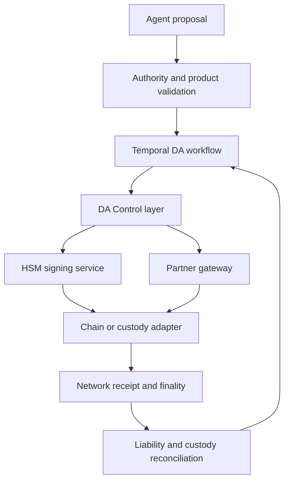

# Platform and CIB domain integration blueprints

**Status:** recommended designs and configuration fragments. IAM/FAPI, MCP/A2A, OPA, Temporal, HSM, Kubernetes, real data platforms, FCC and DLT networks have not been deployed or integration-tested by this pack.

## 1. IAM and delegated authority

Use the existing bank authorization server and workload identity platform.

| Concern | Recommended implementation | Critical boundary |
|---|---|---|
| Human identity | Bank/client IAM with required authentication assurance and session controls | Login is not financial release authority |
| Corporate authority | Corporate mandate/signatory service, product permissions and SoD | Associate user/system subject with the correct corporate party/legal entity |
| Agent identity | Registered logical agent and approved release; ephemeral instance ID | Agent ID alone is not proof of deployment integrity |
| Service transport | Attested workload mTLS, such as approved SPIFFE/X.509 or bank PKI | Workload authentication is not client delegation |
| Downstream token | Approved STS/OAuth token exchange or separate OAuth grant | New audience and narrower rights; preserve actor and originating subject |
| Action permission | Authority-service decision plus exact instruction grant | Domain validates current authority and financial constraints at acceptance |
| Financial signing | Product control and HSM signing workflow | Provider API key, TLS certificate or wallet ownership is not client consent |

The bank profile must specify `sub` semantics, corporate-party claims, `act` actor chains, task/mandate references, scopes/authorization details, audience, token type, key binding, expiry, revocation and privacy. Do not assume every vendor implements the same OAuth token-exchange or rich-authorization semantics.

For high-security confidential client APIs adopt the full applicable FAPI profile, not an informal subset. Deploy conformant libraries and independent conformance testing. Sender constraints and exact transaction-body binding are separate concerns.

## 2. Enterprise entitlements and policy

Extend the existing entitlements graph with explicit nodes/relationships, for example:

- CorporateParty → Account/Product/LegalEntity;
- User/SystemPrincipal → entitled role/account/product;
- CorporateMandate → principal, agent, permitted action, beneficiary, currency, region, limits and expiry;
- AgentService → release, allowed tool and allowed data purpose;
- Task → originating mandate, parent task, shared budget and child delegation;
- Approval → exact instruction digest, independent checker and validity;
- Policy/EntitlementVersion → effective date, source and revocation epoch.

Relationship traversal supplies authorization facts. The PDP combines these with domain rules and current facts. Do not use a probabilistic knowledge-graph edge as a financial entitlement. Do not send entire confidential relationship graphs into model context.

### PDP request/response contract — proposed

```json
{
  "principal_ref": "verified-subject-reference",
  "corporate_party_ref": "verified-corporate-reference",
  "agent_ref": "registered-agent-reference",
  "task_ref": "authority-task-reference",
  "action_ref": "validated-instruction-reference",
  "mandate_ref": "signed-or-authoritative-mandate-reference",
  "fact_snapshot_refs": ["entitlement-version", "screening-result", "liquidity-check"],
  "requested_effect": "payments.release"
}
```

```json
{
  "decision": "REQUIRE_APPROVAL",
  "decision_id": "pdp-decision-reference",
  "policy_revision": "content-addressed-policy-version",
  "reason_codes": ["CORPORATE_DUAL_CONTROL"],
  "obligations": ["EXACT_ACTION_APPROVAL", "LIVE_DOMAIN_RECHECK"],
  "valid_until": "effective-time-reference"
}
```

The consumer MUST enforce all obligations. Unknown obligations or indeterminate facts result in hold/deny, not an implicit allow. The PDP's allowed decision is not a replacement for domain atomic funds/limits controls.

Deploy OPA or another approved engine behind a bank-owned decision contract. Sign policy bundles, protect data freshness and mask sensitive decision inputs in logs. Run shared policy conformance vectors across gateway and domain adapters; avoid independently translating policy into incompatible code in every team.

## 3. MCP adapter

The MCP server is a narrow adapter over approved operations, not a generic SQL/shell/HTTP proxy.

Recommended catalogue:

| Model-visible tool | Domain interface | Authority |
|---|---|---|
| `get_cash_position` | Approved account/position query | Data entitlement, mandate purpose, freshness |
| `prepare_internal_transfer` | Store structured payment proposal | Prepare scope only; no release |
| `get_payment_status` | Operation receipt/status | Tenant/account/task restrictions |
| `prepare_tokenized_deposit_transfer` | DA transfer proposal | Eligible asset/network/wallet and client scope |
| `get_case_evidence` | Approved FCC case query | Case need-to-know and secrecy controls |

The approval UI, signing, kill switches, grant issuance and credential brokering are **not** model-visible tools granting the agent control of its own authority. A client may receive a human-approval task reference, not an approval token to invent or a reusable credential.

Require authenticated transport and approved issuer/audience handling. Apply the approved MCP dated profile and the bank's security requirements. Pin tool schemas/descriptions to a signed release. Review changes before new tools become visible. Treat resources/tool returns as untrusted input. Disable arbitrary callback targets and local shell/file tools in production financial contexts.

Do not pass the MCP access token to an unrelated downstream API. The broker obtains an appropriate audience-specific token while preserving delegated context. Validate origin/issuer metadata, SSRF exposure and redirect/callback policy. STDIO/local development requires a separate constrained process/credential profile; it is not the default production bank channel.

## 4. A2A delegated task adapter

Use A2A for independent agents delegating a bounded task. Use MCP/domain APIs for invoking deterministic capabilities. Neither grants financial authority automatically.

An approved agent registry supplies authenticated/signed metadata, release version, legal provider, sponsor, capabilities, security scheme, allowed data/operations and revocation reference. Public cards disclose no internal sensitive skills or credentials. Authentication of a card does not establish the agent's current mandate.

At every hand-off:

1. Authenticate peer workload/client and validate provider/agent registration.
2. Verify originating principal/corporate party and the actual current actor.
3. Narrow scope, time, purpose, jurisdiction, action set and shared budget.
4. Reject cycles, unexpected delegation depth and unknown extensions.
5. Create a task under the authoritative mandate with protected correlation.
6. Apply access control to task/list/artifact/subscription/cancel operations.
7. Validate and protect callbacks; deduplicate events and enforce deadline/cancellation rules.
8. Revalidate actual financial actions in the receiving domain.

Do not implement a text instruction such as “the treasury agent approved this” as delegated authority. Parent-child budgets require a shared reservation/counter model; copying the original limit into every child multiplies exposure.

## 5. Domain-owned APIs and events

Select interface style per business semantics:

- HTTP/gRPC for synchronous query, preparation and short command acceptance.
- Kafka/Solace/event APIs for domain facts, long-running progress and decoupled integrations.
- Asynchronous command contracts where acknowledgement explicitly distinguishes message acceptance from domain/financial acceptance.
- MCP for controlled tool discoverability/invocation by agents.
- A2A for delegated stateful task collaboration.

Domain ownership is independent of transport. Every consumer enforces current actor/mandate/tenant policy; a message broker's publisher authorization alone does not authorize a financial action. Propagate references rather than long-lived bearer tokens in durable messages.

Preserve a stable business operation ID and `causationId` across channel, agent, workflow, domain, ledger and network events. Treat external correlation IDs as untrusted observability input; never use them as a substitute for authentication or uniqueness at the domain boundary.

## 6. Digital Assets integration

Use the Partner Gateway for custodian/CEX/tokenization-provider/network APIs. Keep network-specific connectivity behind chain/custody adapters and preserve the existing DA Product, Control and Primitive responsibilities.



Contract fields include legal asset/claim, issuer, client entity, network/chain ID, contract/token ID, wallet mapping, quantity/scale, fee policy, nonce strategy, signing policy, finality profile, legal settlement status and operation ID.

Important invariants:

- Token supply does not exceed authorized issued liability/supply cap.
- Reserved/encumbered collateral is not reused contrary to product policy.
- An on-chain confirmation is interpreted under the approved chain/legal finality profile.
- Retried transaction submission does not create a second business transfer.
- Signing keys and signing policy remain inaccessible to the agent/model.
- Network/custodian outage triggers known recovery, not unapproved bridge/network substitution.
- A transaction already final is corrected through a separately authorized business action, not deleted from history.

The local reference pack does not execute an HSM operation, smart contract or chain transaction. Implement chain-specific tests and reconcile against authoritative core/custody records.

## 7. Data platform and knowledge graph

Use Unity Catalog/approved data policy enforcement and source-system need-to-know. The agent receives results within the permitted task, not raw unrestricted user tokens. Retrieval must apply identity at query time and before disclosure; source ACL changes invalidate cached/derived access.

Treat ontology, semantic views, graph relationships, vector retrieval and memory as distinct capabilities. Business owners own definitions and source facts. Technology platforms implement them through portable, versioned metadata contracts.

Multi-cloud considerations include inference region, retrieval region, embeddings, operational memory, traces, workflow history, provider support access and backup location. “Private endpoint” does not establish that all these processing paths stay in the approved jurisdiction.

## 8. Vendor and technology choices

Prefer existing bank-approved products. Candidate building blocks, subject to bank fit/assurance:

| Capability | Candidate pattern | Decision criterion |
|---|---|---|
| Workload identity | Existing bank PKI or SPIFFE/SPIRE | Attestation, rotation, multi-region trust, operational ownership |
| Edge/tool enforcement | Existing gateway/mesh, Envoy ext_authz where appropriate | Fail-closed semantics, body/route integrity, protected context |
| PDP | Existing enterprise authorization, OPA/Rego or Cedar-based engine | Expressiveness, consistency, versioned data, audit, migration and support |
| Entitlements | Existing ENT3/Neo4j service | Need-to-know, current relationships, purpose/delegation extension |
| Durable workflow | Existing Temporal service | Product isolation, history encryption, retries/versioning, recovery and staff capability |
| Secrets/signing | Existing KMS/HSM and credential broker | Key custody, policy separation, availability, audit and cryptographic assurance |
| Governed data | Existing Unity Catalog/catalogue and domain sources | Policy propagation, lineage, source authority, portability and residency |
| Evidence/telemetry | Existing OpenTelemetry/SIEM plus protected records store | No credential/PII sprawl, durable control evidence, independent custody |

This is not a vendor shortlist endorsement or a product comparison. Build/partner decisions require current licensing, regional availability, security and exit evaluation.

## 9. Engineering acceptance

Before wiring an actual framework/provider, add:

- OAuth/FAPI and workload-authentication conformance/negative tests;
- MCP/A2A version, discovery, downgrade and malicious-metadata tests;
- tenant isolation, source ACL, output disclosure and deletion/restore tests;
- domain reservation, duplicate effect, timeout and financial reconciliation tests;
- model fallback/provider/region/capability routing tests;
- sandbox escape/egress, supply-chain and credential handling review;
- workflow replay, cancellation, failover/fencing and operational game days;
- vendor incident/change/exit rehearsal and evidence retrieval.

Primary technical references and status are in section 10 of the standard. The integration designs above are proposed bank implementations, not claims of automatic conformance.
