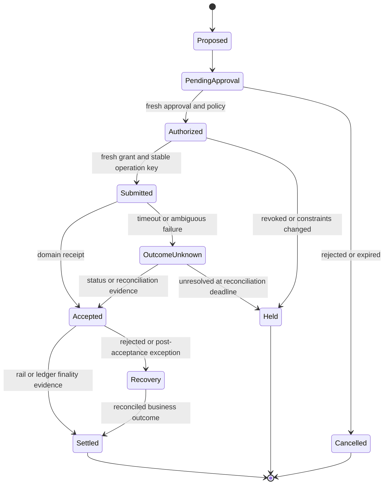

# RI-04 — Temporal execution blueprint

**Status:** design blueprint, not a compiled/tested Temporal SDK integration. Select the bank-approved SDK/server versions, implement Activities and execute replay/failure tests before adopting.

## Ownership

- Agent task workflow: bounded investigation/planning and interaction state.
- Product workflow: authoritative durable business progress for payment/DA journey.
- Agent Authority Service: live mandate, entitlement and action-grant decisions.
- Domain service: final acceptance, exposure reservation, ledger effect and operation receipt.
- External provider/network: its own accepted/settled transaction state.

Separate agent, cash, trade and DA namespaces/task queues according to approved isolation needs. Use Nexus where useful for domain-to-domain operation contracts, but do not add it where normal authenticated domain APIs already provide an adequate contract. A namespace is not a replacement for data/credential/infrastructure isolation.

## Recommended business state machine



An internal book transfer may be booked/final within one domain transaction; an external payment or DvP has additional stages. The state labels must reflect the product's actual legal and operational model.

## Workflow pseudocode

```python
# Illustrative control flow, not runnable Temporal SDK code.
# Workflow inputs/history contain protected references and non-secret IDs.
plan_ref = activity("validate_and_store_proposal", task_ref)
approval_ref = wait_for_authenticated_approval_reference_or_expiry(plan_ref)

# A signal/update reference is not itself an approval. The Activity loads and
# verifies the independent approval service record and current authority.
preflight = activity("recheck_live_authority_and_product_readiness",
                     plan_ref, approval_ref)
if not preflight.allowed:
    return held(preflight.reason)

# Resolve scoped credentials/grant inside this Activity; do not return or
# persist bearer tokens/action grants in Workflow history or search attributes.
# The operation key is stable across attempts, Workflow retries and recovery.
receipt = activity("submit_to_domain_with_fresh_grant",
                   plan_ref, approval_ref, business_operation_id,
                   retry_policy="single-submit-unless-provider-idempotency-proven")

if receipt.outcome_unknown:
    for bounded_attempt in approved_reconciliation_budget:
        status = activity("query_domain_operation", business_operation_id)
        if status.authoritative_result:
            return reconcile_and_record(status)
        durable_timer(backoff_for(bounded_attempt))
    return hold_and_escalate(business_operation_id)

return activity("track_domain_finality_and_reconcile", receipt.reference)
```

## Activity and retry practices

| Operation | Retry recommendation | Reason |
|---|---|---|
| Read approved source/position | Bounded retry with jitter/deadline and current identity | Read still requires access and freshness |
| Model proposal | Bounded attempts/cost; persist chosen proposal; freeze it for approval | Regenerating a proposal after approval must not change the executed instruction |
| Screening/limit precheck | Bounded retry; expiry/failure holds effect | Precheck is not final acceptance |
| Reserve limit/exposure | Idempotent reservation ID; durable status and expiry rules | A timeout is not permission to allocate again |
| Submit with guaranteed domain idempotency | Retry only under the specific contract with the identical operation ID and payload | Receiving domain enforces one effect |
| Submit without proven idempotency | One submission, then status/reconciliation | Blind retries can move money twice |
| Unknown provider outcome | Query/reconcile; do not release reservations based only on local timeout | Provider may have accepted the instruction |
| Recall/reversal/compensation | Separate approved business operation | Original approval cannot authorize a new financial effect |

LLM/API calls belong in Activities, not deterministic Workflow code. Configure Activity timeouts, bounded retries and heartbeat/cancellation support appropriate to the SDK/operation. A cancelled Activity may already have caused a remote effect. Workflow retries do not supply current authority or exactly-once money semantics.

## Security and history

- Pass stable business references and encrypted minimal payloads to Workflows.
- Resolve tokens and secrets only inside short-lived credentialed Activities.
- Apply authenticated authorization to start, signal, update, query, cancel and terminate operations.
- Validate task/tenant/principal binding for updates; a caller cannot approve another customer's task by knowing its Workflow ID.
- Avoid sensitive account/client details in plaintext search attributes and worker logs.
- Revalidate rights after human waits, Workflow recovery and policy changes.
- Version workers/workflows and run replay tests against representative historical executions.
- Separate financial operation IDs from Workflow run IDs so a new run cannot accidentally create a new payment.

## Cancellation/stop semantics

1. Revoke/suspend authority at the authoritative service and stop new acceptance.
2. Stop new planning/tool invocation and record pending tasks.
3. Query all accepted/uncertain domain operations.
4. Initiate a product-specific cancel/recall only where permitted and separately authorized.
5. Reconcile every reservation, ledger/network outcome and client notification.
6. Re-enable under independent review with reduced scope/canary.

Do not terminate the workflow and declare the business outcome cancelled. Preserve enough operational supervision to finish reconciliation even while the reasoning agent remains disabled.

## Acceptance tests required for the actual Temporal integration

- Worker crashes before submission, after submission and before recording the receipt.
- Activity retry receives the original domain result without another effect.
- Model proposal is not regenerated into a different approved instruction on replay.
- Approval/mandate expires during a durable wait.
- Policy, entitlement or beneficiary changes while the workflow is paused.
- Cancellation arrives before and after domain acceptance.
- Failover fences old workers/writers and retains operation/reservation identity.
- Domain/provider status is delayed, duplicated, contradictory or unavailable.
- Namespace/client authorization prevents cross-product and cross-tenant access.

**Primary inputs:** [Temporal workflow determinism](https://docs.temporal.io/workflow-definition), [retry policies](https://docs.temporal.io/encyclopedia/retry-policies), [gateway/Nexus pattern](https://docs.temporal.io/ai/featured/agent-gateway-nexus), [execution versus effect state](https://docs.temporal.io/ai/featured/memory-state-stripe). These are engineering references, not a claim that the blueprint is an executed integration.
