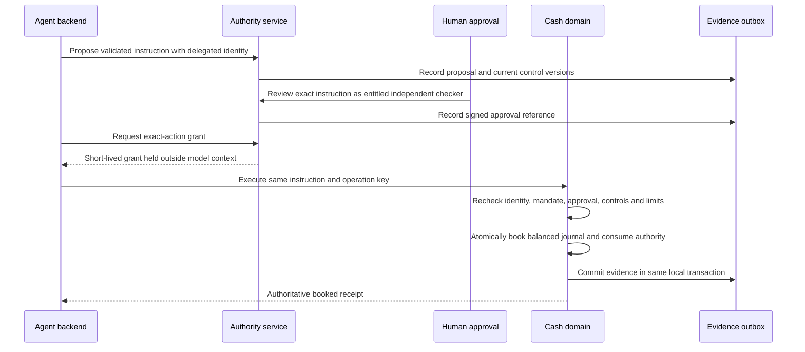

# Reference implementation guide

## 1. Scope and trust assumptions

This pack gives executable control semantics and integration blueprints. It does not implement a complete agent platform, production bank, OAuth server, sanctions engine or DLT network.

All `Identity` objects supplied to public service methods must come from `Runtime.identity()` after token verification at the transport boundary. They are trusted in-process objects, not JSON supplied by a model. Production replaces this seam with the approved resource-server/IAM implementation and authenticated service transport.

The synthetic test realm represents:

- `CORP_A` and `CORP_B`: isolated corporate tenants;
- `maker`: a delegated user entitled to the operating account;
- `treasury-agent`: registered acting agent, bound to `task-1`;
- `checker`: independently entitled approver;
- `operator`: emergency-control administrator;
- `mandate-1`: purpose `payroll`, exact source/beneficiary, expiry and monetary limits;
- `OPS_SGD` / `PAYROLL_SGD`: synthetic same-currency book-transfer accounts.

The synthetic directory overloads `operator` for memory stewardship in tests. A production directory should use explicit separate stewardship, emergency-operations and data-access roles; emergency control authority must not imply broad client-data access.

## 2. Code map

| File | Responsibility |
|---|---|
| `cib_reference/model.py` | Strict Action parser, immutable trusted context, minor-unit money, deterministic action digest and injectable clock |
| `cib_reference/identity.py` | Established JOSE-library verification with issuer/audience/type/algorithm/time restrictions; isolated ephemeral test issuers |
| `cib_reference/policy.py` | Demonstration PDP: principal, agent, mandate, operation, purpose, beneficiary, value date, screening and limits |
| `cib_reference/runtime.py` | Proposal, human approval, capability issuance, acceptance recheck, journal, idempotency, status and suspension/revocation |
| `cib_reference/store.py` | Local transactional state and CloudEvents-shaped audit outbox with hash chain/checkpoint verification |
| `cib_reference/api.py` | HTTP adapter; no token issuance endpoint; no sensitive validation echoes; no-store responses |
| `cib_reference/memory.py` | Purpose-scoped proposed/approved memory with source authorization/version checking and held-data restriction |
| `cib_reference/fixtures.py` | Synthetic IAM/directory/account data and in-process token issuance for testing only |
| `cib_reference/demo.py` | Successful approval plus changed instruction, lost acknowledgement, duplicate retry and suspension demonstration |
| `tests/` | Domain security, concurrency, HTTP and memory tests |

## 3. Financial execution sequence

`propose` and `authorize` are separate because authorization can change while a person reviews the instruction. Execution also rechecks because authorization can change after issuance or while waiting in an acceptance queue.

Capabilities are backend security material. A production MCP/A2A adapter must not return access tokens or action grants in model-visible tool output. It holds them in the credential/control plane and returns only an approved business result or receipt reference.

### 3.1 Exact action binding

The action digest includes operation, source/beneficiary, amount, currency, value date, purpose, mandate ID, idempotency key and schema version. Approval and capability refer to that digest. Changing even one material field produces a different digest.

The demonstration canonicalization is a narrowly defined `cib-action-c14n-v1` profile with validated ASCII identifiers and integer amounts. It is not RFC 8785 JCS. Cross-language production implementations must agree a canonicalization and numeric/string normalization profile, test common vectors and bind any additional product fields such as quote ID, fees, chain ID and contract address.

### 3.2 Live authority and TOCTOU

The capability contains a snapshot of principal, agent and mandate epochs; policy version; approved agent artifact digest; and account/screening versions. At acceptance, the domain verifies that the snapshot still matches and re-evaluates the constraints.

The reference rechecks capability expiry after acquiring its database acceptance transaction, caps grant lifetime to the authenticated principal and mandate validity, and revalidates the approval receipt at execution. Holding a valid old capability does not survive an agent suspension, revoked mandate or changed policy.

Production cannot promise instantaneous global revocation. Define the acceptance linearization point, propagation SLO, caches, race handling and already-accepted effects. A kill-switch command cannot reverse an irrevocable external payment.

### 3.3 Limits, idempotency and money

SQLite `BEGIN IMMEDIATE` serializes the local invariant:

1. Check current authority and mutable constraints.
2. Deduplicate `(tenant, idempotency_key)` and reject a changed payload.
3. Verify sufficient funds and mandate aggregate usage.
4. Debit and credit the same currency.
5. Increase mandate usage.
6. Mark the grant consumed.
7. Save the authoritative receipt and audit outbox event.
8. Commit before acknowledging.

Repeated requests with the same valid instruction return the original payment receipt. They do not create another journal or use more limit. Two separate instructions sharing one mandate are serialized so they cannot both overspend its cumulative cap.

The local aggregate is the lifetime of this mandate, in SGD. Real implementation needs separate corporate/product/issuer limits, daily windows, market calendars, reservation expiry, FX conversion, multi-entity aggregation and incident/stress limits.

For a remote rail, do not assume the local commit and remote effect are atomic. Use the domain's durable operation ID, idempotent provider submission where supported, status lookup, reservations and reconciliation. A timeout or provider `NOT_FOUND` may not prove that no effect occurred.

### 3.4 Evidence

The local outbox uses a CloudEvents 1.0 envelope and hash-linked records. The checkpoint is useful only when stored under independent protection; an attacker who can rewrite the database and its only checkpoint can rewrite the chain. Production needs independent collection, retention lock/WORM where required, protected clocks/identity, custody and access controls.

The demo has no production exporter/inbox, WORM store, replication or SIEM. Export at-least-once using the stable event ID, deduplicate consumers and protect retries/backlogs. Never delete source evidence merely because it has been sent once.

Audit unavailable before commit causes the local financial transaction to roll back, including balances, usage, ledger entries and consumed grant. Central SIEM unavailable is a separate condition: the bank may continue if its approved durable outbox/evidence buffer is healthy and bounded.

## 4. Memory reference

The memory service intentionally supports a low-risk `service-preference` purpose only. Agents may propose a fact; an independently entitled human steward approves it. Retrieval requires:

- current principal identity and source permission;
- correct tenant, principal and purpose;
- approved state and unexpired retention;
- active source with the same source version;
- registered/active agent and approved memory operation if an agent is acting.

Retrieved content is labeled `untrusted-context-data`: even steward-approved facts are data rather than authorization instructions. Memory is never imported by the banking policy evaluator.

The demonstration can hide stale/revoked source data and tombstone an active fact. Legal hold restricts active use and preserves evidence rather than claiming erasure. It does not implement backup expiry, index deletion, distributed caches, data-subject workflows or full record retention.

Production also needs source attestation, sensitive-data classification, legal-basis/consent mapping, source-aware chunking, embedding/index lineage, security-reviewed consolidation, poisoning response and re-deletion on restore.

## 5. Mapping all ten areas to references

| Area | Executable evidence | Production blueprint/replacement |
|---|---|---|
| Architecture principle | Typed proposal/approval/acceptance boundaries | Service/release manifests, domain ownership, consequence/autonomy classification |
| Controls | Exact digest, current-state recheck, mandate and aggregate limits, independent approval | Enterprise PDP/limits/FCC/mandates; reservations and product controls |
| Digital channels | Verified HTTP identity, no spoofable body/header identity, status and control routes | Full FAPI/IAM, trusted approval UX, corporate signatory/consent and channel fraud |
| Interoperability | Typed contracts and stable operation/idempotency semantics | MCP/A2A adapters, STS/token exchange, registered cards/tools, protected callbacks |
| Operating model | Separate maker/checker/operator test principals | Explicit ownership, reviewer capacity, 24x7 coverage, incident/remediation and lifecycle |
| Resilience | Duplicate/concurrency tests, lost ack, current approval, stop/revoke | Temporal, real-rail reconciliation, DR/fencing and safe return to service |
| Security | Asymmetric signature verification, issuer/audience/type restrictions, fixed tool set, least-scope checks | mTLS/DPoP/workload attestation, KMS/HSM, sandbox/egress, penetration testing |
| Data governance | Source-aware memory and protected-reference audit pattern | Catalogue, data residency, data lifecycle, source ACL enforcement, independent evidence |
| Vendor strategy | Explicit interfaces and no provider-specific core business objects | Provider/region change gate, concentration map, contract assurance and stressed exit |
| Regulatory readiness | Reconstructable control references and negative-path tests | Jurisdictional applicability, meaningful oversight, WORM/records and independent sign-off |

## 6. Error model

| Class | Example | Handling |
|---|---|---|
| Authentication | Invalid/expired token, audience/type mismatch | Reject; refresh/re-establish legitimate identity outside the model |
| Authorization/business denial | Revoked mandate, changed beneficiary, per-action cap | Do not retry blindly; new approved instruction or human escalation |
| Stale decision | Policy/entitlement/approval version changed | Revalidate and obtain a fresh action-bound authorization/approval as required |
| Idempotency conflict | Original key with another payload | Reject; investigate caller defect or tampering |
| Dependency unavailable | Durable evidence/control fact unavailable | Hold new consequential acceptance; preserve existing state |
| Outcome unknown | Lost acknowledgement after domain acceptance | Query and reconcile original operation key; no new key/submission |

The sample returns safe error codes and avoids echoing request content in validation errors. Production should use a bank error vocabulary/Problem Details profile with correlation, support references and disclosure rules.

## 7. Things the local tests do not establish

No claims are made about production throughput, latency, multi-region behaviour, regulatory approval, model accuracy, model alignment, real sanctions/fraud detection, HSM controls, FAPI certification, live client authorization, real settlement finality, source-data legality, or safety of an arbitrary agent framework. See the production-readiness gate for required integration and assurance work.
